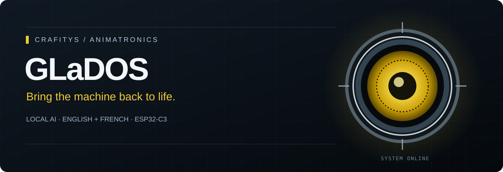

<div align="center">



# Crafitys GLaDOS

### Print her. Build her. Bring her back to life.

A talking, moving GLaDOS animatronic powered by a local AI on your PC and an **ESP32-C3 Super Mini**.

[**Download the complete software + voices**](https://github.com/Crafitys/Crafitys_Glados/releases/latest/download/Crafitys_Glados.zip) · [**Start the installation**](docs/INSTALL.md) · [**Get the STL files & assembly manual**](https://cults3d.com/fr/utilisateurs/Crafitys/fichiers-3d)

</div>

She listens to your question, answers in her unmistakably cold style, and moves while speaking. A round animated eye, head movements and spontaneous idle gestures bring the printed character to life.

**The software and firmware are here. The STL files and mechanical assembly instructions are available on [Crafitys on Cults3D](https://cults3d.com/fr/utilisateurs/Crafitys/fichiers-3d).**

## What you get

- **English and French editions:** speech recognition, AI replies and a matching GLaDOS voice.
- **Local AI:** `huihui_ai/qwen3.5-abliterated:4B` through Ollama.
- **Local speech recognition:** faster-whisper on the PC.
- **Local speech synthesis:** both Piper voice models are included.
- **Three animated axes:** eye up/down, head left/right tilt, and head up/down tilt.
- **A 240 × 240 GC9A01A round display**, eye effects and an LED output.
- **Six speaking animations**, smooth servo trajectories and independent idle movements.
- **A dedicated calibration mode** for adjusting each axis separately.

The PC runs the speech and AI software. The ESP32-C3 runs the motors and eye display, connected to the PC by USB. Initial installation downloads Python packages, Whisper and the Ollama model. Once those downloads are complete, the conversation pipeline can run locally without a paid API.

## Build path

| Step | Guide | Result |
| --- | --- | --- |
| 1 | [PC installation](docs/INSTALL.md) | Python environment, Ollama and voices ready |
| 2 | [ESP32-C3 firmware upload](docs/ARDUINO.md) | Correct board selected and firmware flashed |
| 3 | [Wiring and motor identification](docs/WIRING.md) | Every signal connected to the correct GPIO |
| 4 | [Motor travel calibration](docs/CALIBRATION.md) | Eye, roll and pitch limits matched to your build |
| 5 | [Run GLaDOS](docs/INSTALL.md#run-glados) | Press Enter, speak and hear her reply |

**Before powering an assembled mechanism, read the calibration guide.** The stepper has no reference sensor: its boot movement assumes a known physical starting pose. For first calibration, disable the automatic boot travel and start the firmware in calibration mode, as explained in the guide.

## Which motor is which?

| Physical movement | Firmware motor | GPIO | Travel settings |
| --- | --- | --- | --- |
| Eye tilts up/down | `servo1` | **6** | `SERVO1_MIN`, `SERVO1_MAX`, `SERVO1_INIT` |
| Head tilts left/right, like a sideways lean (**roll**) | `servo2` | **7** | `SERVO2_MIN`, `SERVO2_MAX`, `SERVO2_INIT` |
| Head tilts up/down, like a nod (**pitch**) | NEMA stepper | **STEP 3**, **DIR 10** | `NEMA_MIN_POS`, `NEMA_MAX_POS`, `NEMA_CENTER_POSITION` |

Servo targets are commanded angles in degrees. Stepper targets are counts of driver STEP pulses, dependent on your driver microstep setting and transmission. These values are not interchangeable.

## Choose your language

With your virtual environment activated, run one of these commands from the project folder:

```bash
python glados.py
```

English recognition, English replies and the English GLaDOS voice.

```bash
python glados_fr.py
```

French recognition, French replies and the French GLaDOS voice. All installation documentation is in English.

Wait until the terminal says **Press Enter, then speak**. Press Enter and ask your question. Recording ends automatically after one second of silence. Use **Ctrl+C** to stop.

For a first test, you can run the PC software with the ESP32 disconnected: speech still works and the terminal reports serial reconnection attempts.

## Hardware at a glance

| Component | Purpose |
| --- | --- |
| PC with microphone and speakers | Runs Ollama, Whisper and Piper |
| ESP32-C3 Super Mini, 4 MB flash | Motor control, eye display and USB serial |
| Two suitable servos; reference build uses 15 kg·cm class servos | Eye tilt and head roll |
| NEMA stepper and STEP/DIR driver | Head pitch |
| GC9A01A round SPI display, 240 × 240 | Animated eye |
| Suitable motor power supplies with a common signal ground | Powers the servos and driver |
| USB data cable | PC to ESP32-C3 communication |

The documented PC path is **Linux (Ubuntu/Debian)**. A Windows setup is also provided, with platform-specific keyboard and serial handling; physical testing on Windows is still needed. Speech recognition and Piper use the CPU by default, leaving a compatible GPU available to Ollama. See the installation guide for practical PC requirements.

## Repository contents

| Path | What it contains |
| --- | --- |
| `glados.py` | English launcher and shared conversation/motor control code |
| `glados_fr.py` | French language and voice configuration |
| `requirements.txt` | Python dependencies |
| `voices/` | Voice JSON configurations; the complete release also includes both ONNX models |
| `tools/download_voices.py` | Installs and verifies voices when using a Git clone or source ZIP |
| `firmware/glados/glados.ino` | ESP32-C3 firmware, eye graphics and calibration commands |
| `tools/check_setup.py` | Checks dependencies, voices, audio, serial ports and Ollama |
| `tools/test_voice.py` | Tests one voice independently |
| `tools/serial_console.py` | Sends serial test and calibration commands |
| `docs/` | Installation, firmware, wiring, calibration and troubleshooting |
| `assets/` | Project banner and signal connection diagram |

No persistent personal profile is stored. The conversation keeps at most three recent turns in RAM and loses them when the process stops. Microphone recordings and generated speech are handled in RAM by the application; transcripts and replies are displayed in the terminal. See [configuration](docs/CONFIGURATION.md) to disable conversation context or spontaneous thoughts.

## Need a hand?

Start with [troubleshooting](docs/TROUBLESHOOTING.md) and run:

```bash
python tools/check_setup.py
```

To report an issue, include your operating system, Python version, ESP32 board selection, library versions and the error message. Remove any private conversation text before sharing terminal output.

## Credits and assets

Created by **Crafitys**. GLaDOS and Portal are associated with Valve; this is a fan-made animatronic project. This repository does not include the STL files or mechanical assembly manual: get those from [Crafitys on Cults3D](https://cults3d.com/fr/utilisateurs/Crafitys/fichiers-3d).

Dependencies and AI models have their own terms. See [asset and dependency notices](ASSET_NOTICES.md) and [verification notes](docs/VERIFICATION.md) for what was checked in this software package.
