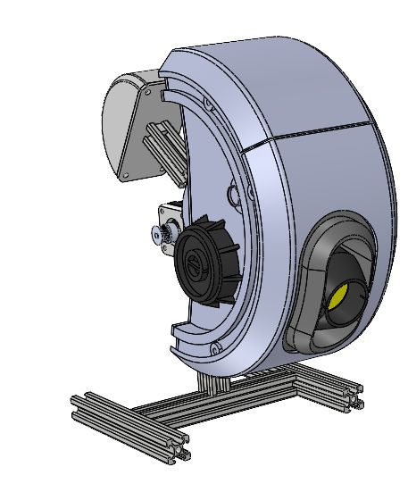

# Assemble your GLaDOS

The printed head, servo eye and belt-driven pitch mechanism become a three-axis animatronic. Use Crafitys' illustrated manual alongside the shopping list and electrical guide.

**[Open / download the 18-page assembly manual](assembly/Glados_Assembly_Instructions.pdf)** · [Complete bill of materials](BOM.md) · [Get the STL files on Cults3D](https://cults3d.com/fr/utilisateurs/Crafitys/fichiers-3d)

The manual is Crafitys' supplied English PDF, included unchanged. STL files remain available through the Cults3D listing.

## Find the right step

| PDF pages | Assembly stage |
| --- | --- |
| 2–4 | Fit the round display, red LED and eye servo |
| 5–6 | Assemble the head plates, M5 inserts and ears |
| 7–9 | Fit the roll servo, bearings and 47 mm extrusion |
| 10–11 | Fit the pulley, counterweight support and 60 mm extrusion |
| 12–13 | Assemble the pivot, 150 mm extrusion and locking plate |
| 14–15 | Mount the NEMA 17 and tension the GT2 belt |
| 16–17 | Build the base, attach the head and fill the counterweight |
| 18 | Completed mechanical assembly |

## Plan before you cut or power the motors

- Use the [BOM](BOM.md) to check exact screw sizes, insert pockets, extrusion stock and the approximately 1 kg counterweight filling.
- The manual gives 47 mm, 60 mm and 150 mm extrusion lengths; verify the pictured base and allow for saw kerf before cutting the full stock.
- Follow [calibration](CALIBRATION.md) when fitting servo horns and linkages: the firmware commands initial servo angles. Establish a reference pose for the stepper before powered testing.
- Follow the [electrical power map](WIRING.md) for USB-C, external motor power and common GND. The mechanical PDF is not an electrical wiring guide.

Continue with [ESP32-C3 flashing](ARDUINO.md), [wiring](WIRING.md) and [motor travel calibration](CALIBRATION.md) before running automatic movements.
