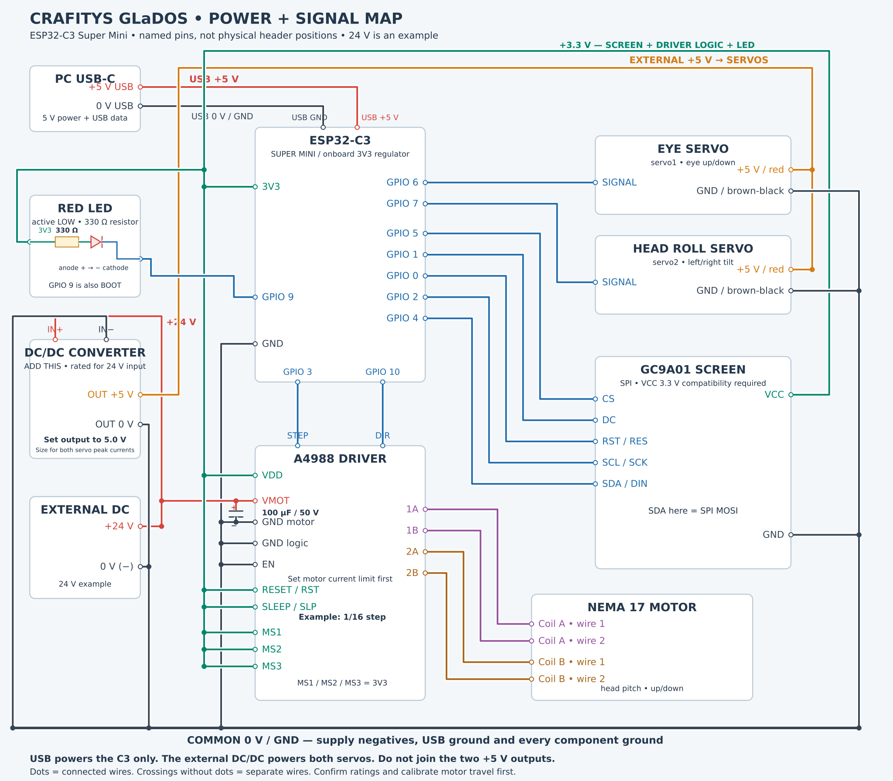

# Basic wiring: ESP32-C3, A4988 and three motors

Use the **ESP32-C3 Super Mini** with `firmware/glados/glados.ino`. Read the pin names printed on each board: **GPIO numbers are not header positions**. The [electrical parts list](HARDWARE.md) identifies the components supplied for this build.



Each rectangle represents a component, with its named pins and connecting wires. Pin positions are schematic: follow the labels on your actual boards. **Dots join wires; crossings without dots do not.** Winding colours identify coil pairs, not the actual motor cable colours.

The map uses an **A4988 carrier**, an **external 24 V DC example**, a **24 V → 5 V DC/DC step-down converter** for the servos, and an **illustrative 1/16-step setting**. Confirm the motor/driver ratings and both servos' 5 V compatibility. These microsteps were not established by the supplied list or code: calibrate your build before using the supplied movement limits. A suitable 12 V motor supply can also be used, with a converter rated for that input.

### Follow the power paths first

| Power source | Connect to | Voltage/reference |
| --- | --- | --- |
| PC USB-C data cable | ESP32-C3 USB-C connector | USB +5 V and USB GND, inside the cable; the board creates 3.3 V |
| External DC supply **+24 V** | A4988 **VMOT** and converter **IN+** | 24 V example, never directly to servos or the C3 |
| External DC supply **−** | Converter **IN−** and common **GND** | **0 V / GND**, not a −24 V rail |
| Converter **OUT+**, adjusted and measured at **5.0 V** | Both servo positive wires | External +5 V, independent of USB +5 V |
| Converter **OUT−** | Both servo grounds and common **GND** | **0 V / GND**, not a −5 V rail |
| C3 **3V3** | Screen VCC if compatible, A4988 VDD/RESET/SLEEP/MS pins, LED resistor | 3.3 V logic rail |

The USB cable also carries serial data; its data conductors are not drawn individually. **Do not connect the converter's +5 V output to the USB +5 V/C3 5V rail.** USB powers the C3; the converter supplies the servos. Size the converter for both servos' peak current and the external supply for both the driver and converter loads. Set and measure converter output before connecting the servos.

## 1. Connect the two servos

| From | Connect to | Purpose |
| --- | --- | --- |
| C3 **GPIO 6** | Eye servo signal wire | Eye up/down: `servo1` |
| C3 **GPIO 7** | Head roll servo signal wire | Head left/right tilt: `servo2` |
| External servo supply **+** | Both servo positive wires, usually red | Motor power at the rated servo voltage |
| External servo supply **− / GND** | Both servo ground wires, usually brown/black, and C3 GND | Common ground |

The signal wire is usually orange, yellow or white. Confirm your connector rather than relying only on wire colours. Use the servo's specified voltage; **5–6 V is an example for compatible servos**, not a verified rating for the linked pack. Size the supply for both servos' peak current. Power the servos externally, with grounds joined to the C3.

The left/right servo produces a sideways head lean (**roll**). The NEMA stepper below produces an up/down nod (**pitch**).

## 2. Connect the round SPI screen

| From the C3 | Connect to the display |
| --- | --- |
| **GPIO 5** | **CS** |
| **GPIO 1** | **DC** |
| **GPIO 0** | **RST / RES** |
| **GPIO 2** | **SCL / SCK / CLK** |
| **GPIO 4** | **SDA / DIN / MOSI** |
| **3V3** | **VCC**, only after confirming that this breakout accepts a 3.3 V supply |
| **GND** | **GND** |

This is **SPI**: the display's SDA label means MOSI data, not an I²C connection. There is no MISO wire. If your breakout requires a different VCC supply or has a BL/backlight input, follow its own documentation; retain 3.3 V-compatible C3 signal levels. Do not assume the linked screen is identical to another GC9A01 module.

## 3. Connect the A4988 driver

The driver has two power inputs: **VDD** for logic and **VMOT** for motor power. Keep them separate.

| A4988 pin | Connect to | Purpose |
| --- | --- | --- |
| **STEP** | C3 **GPIO 3** | Step pulses |
| **DIR** | C3 **GPIO 10** | Direction |
| **VDD** | C3 **3V3** | 3.3 V logic supply |
| **GND**, both driver ground pins | Common **GND** | Logic and motor return |
| **VMOT** | Motor supply **+**; 24 V DC is the map's example | Motor power |
| **EN / ENABLE** | **GND** | Keeps outputs enabled; the firmware does not control EN |
| **RESET / RST** | **3V3** | Holds reset inactive |
| **SLEEP / SLP** | **3V3** | Keeps the driver awake |
| **MS1**, **MS2**, **MS3** | All to **3V3** in this example | Selects 1/16 microsteps |
| **1A + 1B** | The two wires of motor coil A | First winding |
| **2A + 2B** | The two wires of motor coil B | Second winding |

RESET and SLEEP can be bridged together and connected to 3V3. Join the motor supply negative to common GND. Keep the printed module pin names authoritative: clones can differ in orientation.

**Add a capacitor across VMOT and its nearby GND.** Put its **+ lead on VMOT** and its **− lead on GND**. Use at least 47 µF; the map shows **100 µF / 50 V for the 24 V example**, close to the driver. A 100 µF / 25 V capacitor is an example for 12 V, not for this 24 V setup. The A4988 carrier reference supports an 8–35 V motor supply; verify your actual module and set the motor phase-current limit below before use. Long supply leads can cause destructive voltage spikes even below the nominal maximum.

### Identify the two motor wire pairs

With everything unpowered, use a multimeter's resistance/continuity function. Two wires from the same winding show a low resistance; wires from different windings do not form a pair. Connect one complete pair to 1A/1B, and the other pair to 2A/2B. Check the motor datasheet if it has more than four wires. Wire colours alone do not identify the pairs.

### Select microsteps before calibration

| MS1 | MS2 | MS3 | Setting |
| --- | --- | --- | --- |
| GND | GND | GND | Full step |
| 3V3 | GND | GND | 1/2 step |
| GND | 3V3 | GND | 1/4 step |
| 3V3 | 3V3 | GND | 1/8 step |
| 3V3 | 3V3 | 3V3 | **1/16 step: the diagram's example** |

These are hardware settings. Keep an already calibrated build's setting. Changing it changes the distance moved per STEP pulse and requires recalibrating `NEMA_MIN_POS`, `NEMA_MAX_POS`, `NEMA_CENTER_POSITION`, startup travel and animation targets. The example does not prove that the supplied targets suit your mechanism.

### Set the driver current limit

Before motor testing, establish the motor's rated phase current and your carrier's sense-resistor value. For the A4988:

```text
VREF = 8 × I_LIMIT × R_SENSE
```

Use volts, amperes and ohms. Choose a limit within both the motor rating and your module's cooling capability. Measure VREF against driver GND and use the module's adjustment procedure. There is no universal potentiometer position or VREF for all clones. The current at the power supply is not the winding current.

## 4. Connect the red LED

The existing firmware uses **GPIO 9, active LOW**. Wire the circuit in this order:

| Connection | Wire to |
| --- | --- |
| C3 **3V3** | One end of a **330 Ω resistor** |
| Other resistor end | LED **anode (+)** |
| LED **cathode (−)** | C3 **GPIO 9** |

For a typical through-hole LED, the long lead is the anode and the flat side/short lead marks the cathode. LOW lights the LED; HIGH turns it off. Use a bare red indicator LED compatible with this circuit, not an unknown powered LED module.

GPIO 9 is also **BOOT**. The LED circuit must not hold it low during normal startup. GPIO 2, used for display clock, is also a C3 boot strapping pin; attached circuitry must preserve the board's startup levels. Some Super Mini boards have an onboard GPIO 8 LED; that is separate from this GPIO 9 output.

## 5. Join the grounds, keep power rails separate

| Supply or component | Connection |
| --- | --- |
| PC USB data cable | C3 USB connector: board power and serial data |
| C3 GND | Common ground junction |
| Converter IN−/OUT− and both servo ground wires | Common ground junction |
| Motor supply negative and both A4988 GND pins | Common ground junction |
| Display GND | Common ground junction |

**Common GND is the shared electrical reference.** Use suitable power wiring and a distribution junction for motor return currents, with a ground connection to the C3. Route motor power returns through the distribution wiring, not through the C3 board. The USB +5 V, external servo +5 V and motor +24 V outputs remain separate. Do not feed 24 V (or 12 V) to the C3, display, LED or servos. Do not power either motor type from a GPIO or the C3 3V3 regulator. For this USB-powered arrangement, do not also wire an external positive supply into the C3 5V pin.

## 6. First power-up

1. Disconnect all supplies before wiring. Confirm polarity and winding pairs. Adjust and measure the converter at 5.0 V before attaching compatible servos.
2. Before flashing an uncalibrated build, set `NEMA_BOOT_TRAVEL_STEPS = 0` and `CALIBRATION_ON_BOOT = true`. Flash with external motor supplies off.
3. Test the C3/display by USB first. A servo still receives its initial angle when powered: fit horns/linkages using the [calibration procedure](CALIBRATION.md).
4. Set the A4988 current limit, then power and test each axis in small increments from a known reference pose.
5. Finish travel calibration before enabling automatic animations or startup travel. Never connect or disconnect motor wires while the driver is powered.

## Reference documents

- [Allegro A4988 datasheet](https://www.pololu.com/file/0J450/A4988.pdf): logic, current-limit equation and microstep states.
- [Pololu A4988 carrier guide](https://www.pololu.com/product/1182): carrier wiring, supply separation and VMOT capacitor. Use it as a carrier reference, then confirm your actual module.
- [Espressif C3 strapping-pin explanation](https://espressif.github.io/esp32-c3-book-en/chapter_5/5.2/5.2.6.html): boot-time pin levels.

The GPIO mapping comes from the project's firmware. This diagram has been checked against that mapping and the A4988 references; the assembled hardware has not been electrically or mechanically tested here.
