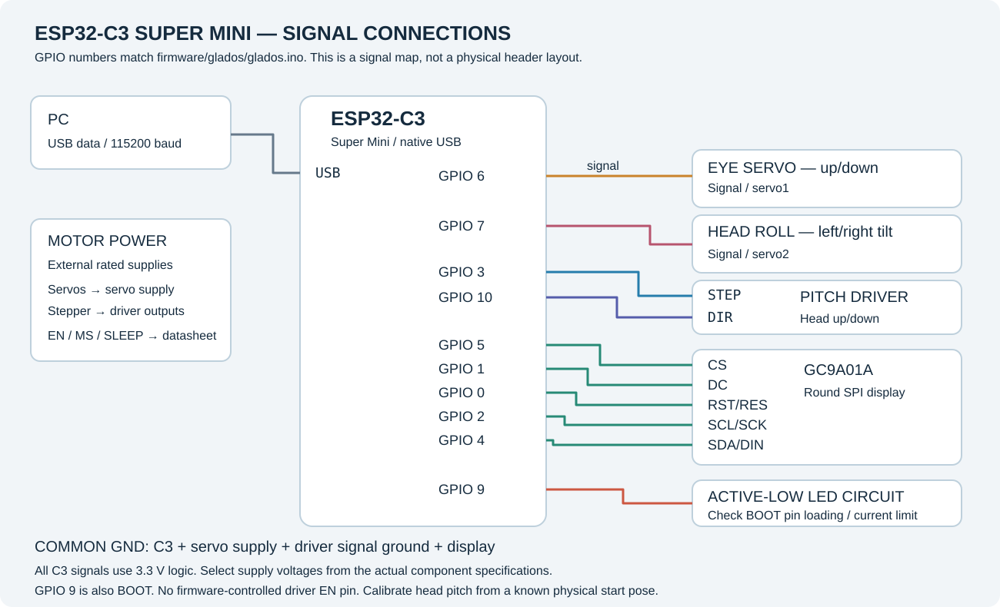

# Wiring and motor identification

The table below is taken from `firmware/glados/glados.ino`. Numbers mean **GPIO numbers**, not the physical order of the pins on a header. This pinout is for the **ESP32-C3 Super Mini**.

## Signal connections

| ESP32-C3 GPIO | Firmware name | Connect to | Function |
| --- | --- | --- | --- |
| **6** | `PIN_SERVO_1` | Eye servo signal | Eye tilts up/down |
| **7** | `PIN_SERVO_2` | Head roll servo signal | Head tilts left/right |
| **3** | `PIN_STEP` | Stepper driver STEP | Head pitch step pulses |
| **10** | `PIN_DIR` | Stepper driver DIR | Head pitch direction |
| **5** | `TFT_CS` | Display CS | SPI chip select |
| **1** | `TFT_DC` | Display DC | Data/command |
| **0** | `TFT_RST` | Display RST / RES | Display reset |
| **2** | `TFT_SCLK` | Display SCL / SCK | SPI clock |
| **4** | `TFT_MOSI` | Display SDA / DIN / MOSI | SPI data from C3 |
| **9** | `PIN_LED` | Compatible active-low LED circuit | LED effect; shared with the BOOT function |
| **GND** | — | All signal grounds | Common reference |
| **USB** | `Serial` | PC USB data port | 115200-baud command link |

On this SPI display, a label such as **SDA** means the serial data input connected to MOSI; this firmware does not use I²C. There is no MISO connection. If your module has a backlight pin, connect it according to that module's specification: the firmware has no dedicated backlight GPIO.

## Power connections

Servos and the NEMA motor need appropriately rated external supplies. Do not power the motors from a C3 GPIO or its 3.3 V regulator. Match servo supply voltage to the servo's datasheet, and match the driver supply and current limit to the stepper and driver.

Join the C3 ground, servo supply ground and driver signal ground. The signal diagram shows the control wires; it is not a supply-voltage prescription for every possible driver or display board.

The firmware does **not** drive the stepper driver's EN pin. Set EN, RESET and SLEEP, if present, according to the specific driver datasheet. For an active-low EN input that needs to stay enabled, its documented low level is typically used; verify your actual driver rather than assuming every module has the same enable circuit.

Driver MS/microstep pins are also configured by the wiring. Changing them changes the physical movement produced by a given `NEMA_*` value, so the stepper must be recalibrated afterwards.

For the display, check the supply voltage allowed by the actual breakout. All C3 GPIO signals are 3.3 V logic. The uploaded package does not identify the exact driver or display breakout power circuitry, so a universal power-connector diagram would be misleading.

## The three axes in plain language

- **Eye servo, GPIO 6:** moves the eye itself up and down.
- **Head roll servo, GPIO 7:** leans the whole head left and right. This is roll, not a horizontal pan.
- **Head pitch stepper, GPIO 3/10:** nods the whole head up and down through the transmission.

The screen's animated eye is a separate visual effect; `eyeTimeMs` in an animation affects the display, not the eye servo's travel setting.

## LED polarity and C3 boot pins

The supplied LED logic is **active low**: HIGH is off, LOW is on. For a compatible external indicator, use a suitable current-limited circuit with that polarity. Super Mini boards may also have an onboard LED on GPIO 8; that LED is not the GPIO 9 output used by this firmware.

GPIO 2 and GPIO 9 are C3 strapping pins. Connected circuitry must allow the board to reach the correct startup levels. GPIO 9 must not be held low by the LED circuit during normal boot.

## Driver-specific details to confirm

Before translating the signal diagram into a full power-wiring diagram, identify the driver model, its EN/RESET/SLEEP requirements, its configured microsteps, the stepper winding pairs, supply ratings and the display breakout's voltage support. The software does not contain these physical component specifications.
